# Connecting to Your Workshop Environment

!!! tip "Here is our plan for this lesson:"

    1. Connect to your VM and sign in to **Automation Cloud**.
    2. Confirm you're on the workshop tenant in **Studio Web**.

## Goal

By the end of this lesson you'll have a VM open in your browser and **Studio Web** open on the workshop tenant. You'll start **Codex** in the next lesson, from inside your working folder.

## What's already on the VM

The VM already has Codex CLI, the UiPath CLI, the UiPath skills, and both logins in place. Apart from creating your working folder in the next lesson, Codex runs every command for you.


## Steps

### 1. Connect to your VM

On your workshop page, find the **Sandbox** row. We recommend "**Connect in browser**": it opens your VM through **Azure Bastion**, right in a browser tab. Use the username and password shown under **Sandbox sign-in** to log into the VM.

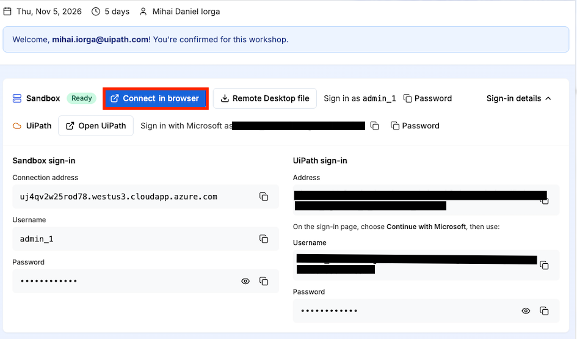{ .screenshot width="900" }

The Bastion login asks for the same username and password:

[[[
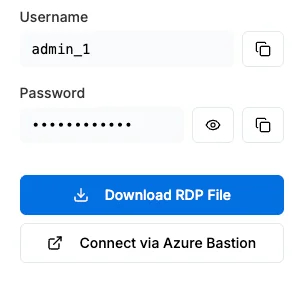{ .screenshot }
|50|
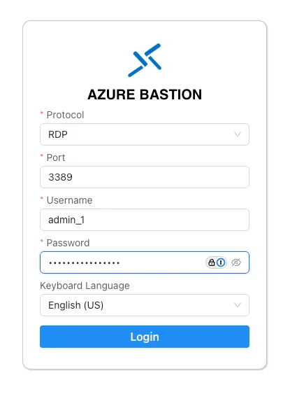{ .screenshot }
]]]

**You should see a notification asking you whether you want to allow clipboard access. Please accept.**

You should see the VM load in that browser tab:

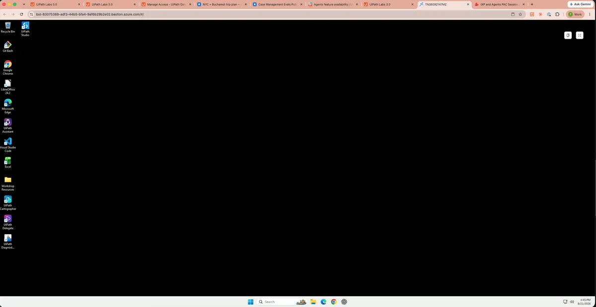{ .screenshot width="900" }

### 2. Open the workshop tenant

Perform the rest of the steps in this guide ***inside the VM***.

Open the Chrome browser and open a tab to:

```text
https://cloud.uipath.com/tpenlabs/AgenticAdvancedWorkshop/
```

!!! tip "Can't paste into the VM?"
    If you can't paste into the VM using **CTRL+V**, visit `chrome://settings/content/clipboard` in the browser and make sure Bastion isn't blocked from using the Clipboard.

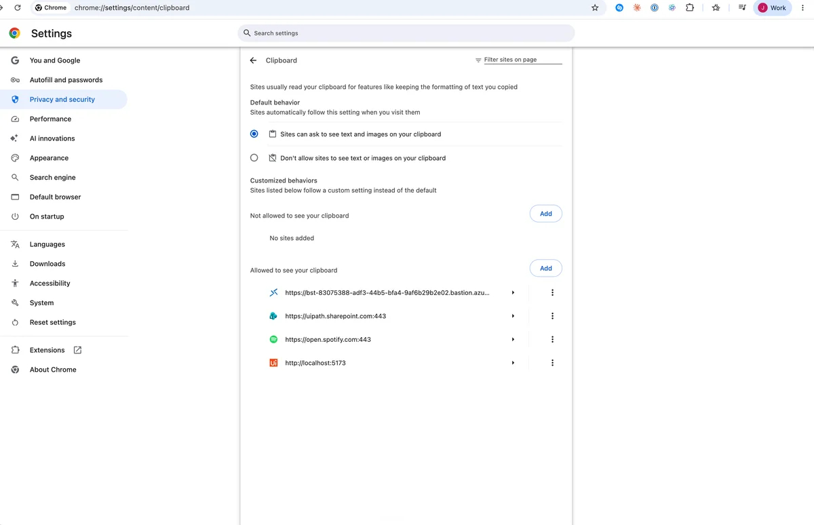{ .screenshot width="900" }

### 3. Sign in to Automation Cloud

[[[
Choose "**Continue with Microsoft**" to log in.
|30|
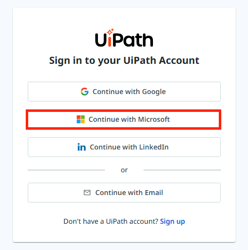{ .screenshot }
]]]

[[[
Use your provided username and password in the "**Your Workshop Account**" area for login.

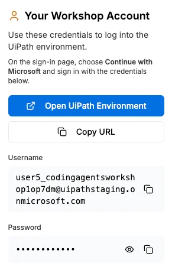{ .screenshot }
|50|
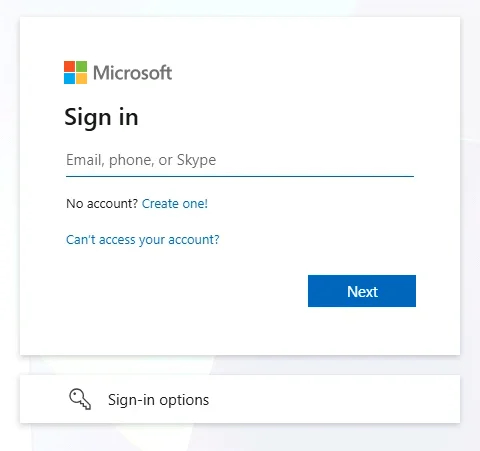{ .screenshot }

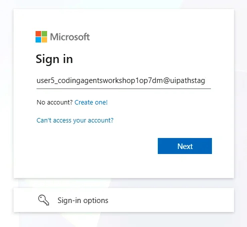{ .screenshot }

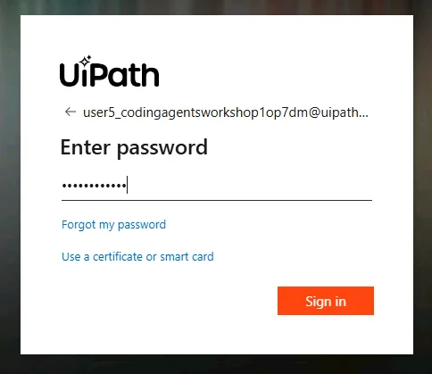{ .screenshot }
]]]

### 4. Confirm the tenant in Studio Web

Once in Automation Cloud, navigate to [**Studio Web**](https://cloud.uipath.com/tpenlabs/studio_/projects) and confirm the tenant picker shows the workshop tenant **AgenticAdvancedWorkshop** in the upper right corner.

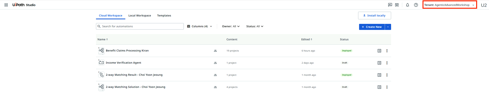{ .screenshot width="900" }

!!! tip "Checkpoint"
    Studio Web is open on the workshop tenant.
