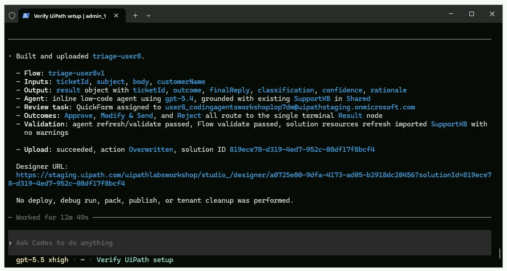
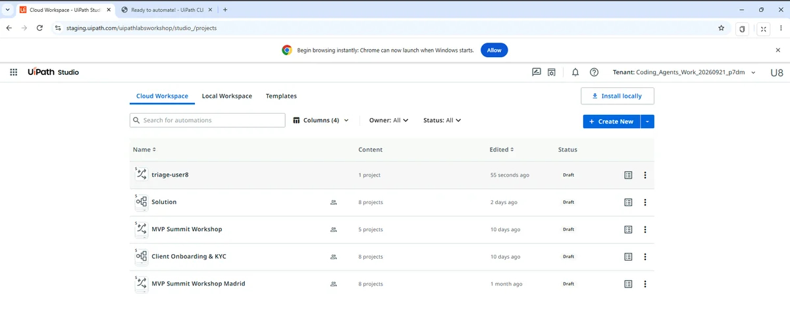
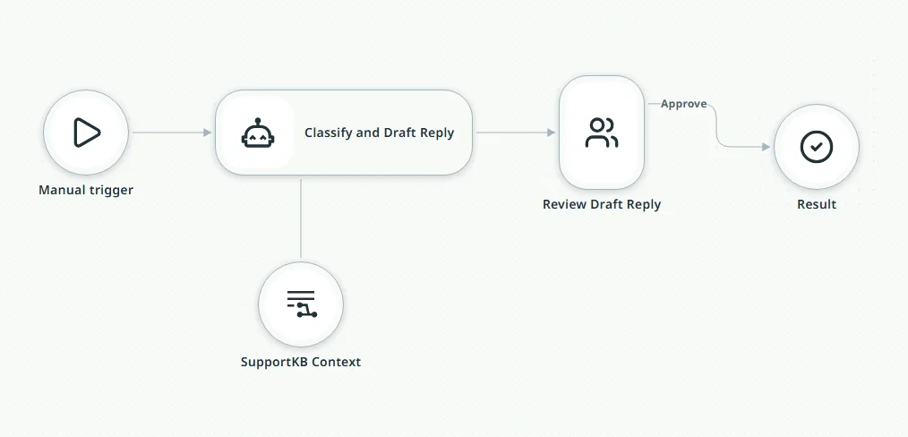
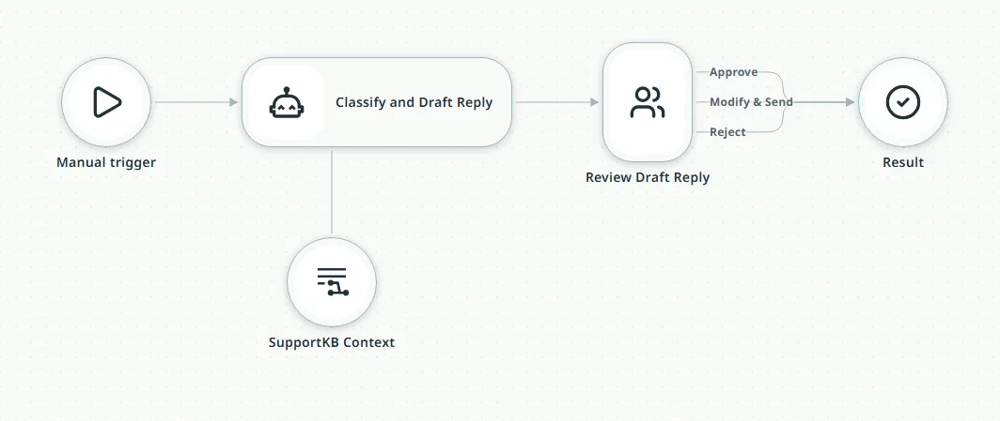
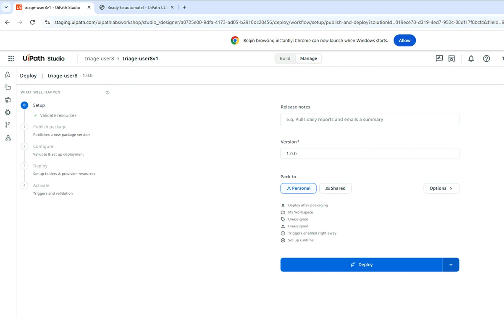
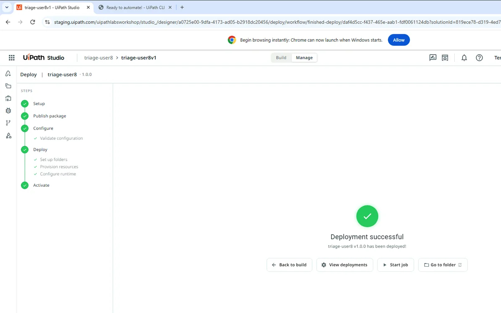

# Building and Deploying V1

!!! tip "Here is our plan for this lesson:"

    1. Ask **Codex** to build the first **Maestro Flow** version, V1.
    2. Inspect the flow in **Studio Web** and connect any missing outcome lines.
    3. Deploy V1 from Studio Web into your personal workspace.

## Goal

By the end of this lesson you'll have V1 deployed: a flow that takes a support ticket, lets an inline agent classify it and draft a reply grounded in the **SupportKB** index, and sends every draft to an **Action Center** review task assigned to you. V1 is deliberately simple. It's the baseline you measure the next two versions against.

## What V1 looks like

In the designer you see trigger, agent (with a knowledge attachment), review task, end. The review task has three outcomes, **Approve**, **Modify & Send**, and **Reject**, and all three route to a single terminal result.

Deploying is the one browser step you repeat three times today. Codex builds, validates, and uploads; you click **Deploy** in the designer.

## Steps

### 1. Prompt 2: build V1

!!! info "For this step, Codex will work for 10-12 minutes."

Paste the build prompt:

```text
Build a Maestro Flow solution named after my team code from AGENTS.md (for example triage-user24), with a flow named my team code followed by v1 (for example triage-user24v1). It takes a support ticket (ticketId, subject, body, customerName) as inputs. An agent classifies it and drafts a reply grounded in the existing SupportKB index in the Shared folder, then an Action Center task assigned to me lets me Approve, Modify & Send, or Reject. Keep ticketId on the task and the final output, and route all three action center outcomes to a terminal result. Validate it, refresh the solution resources so the index links up, upload it to Studio Web, and give me the designer URL.
```

{ .screenshot width="900" }

### 2. Inspect the flow in Studio Web

[[[
When Codex finishes, refresh the Studio Web view and open the project created "**triage-user[number]**".
|30|
{ .screenshot }
]]]

Take a look at the Flow Codex created.

{ .screenshot width="900" }

Attach any missing outcome lines from the Action Center task to the end node.

{ .screenshot width="900" }

!!! tip "Checkpoint"
    Codex reports a designer URL, `flow validate` passed, and `solution resources refresh` imported the index (it should say "Imported 1", not "Created"). In the designer you see trigger, agent (with a knowledge attachment), review task, end. In the task node's recipient, the assignee is type "user" with your email, not the default "group". Warnings about outcomes without downstream nodes are fine; they don't block deploy.

### 3. Deploy V1 from Studio Web

The deploy log runs for about a minute.

1. In the designer, click **Deploy**.
2. Leave "**Pack to**" on **Personal**. This deploys into your own personal workspace.

    { .screenshot width="900" }

3. Click **Deploy** in the wizard and watch the log for "**All services activated successfully**".

    { .screenshot width="900" }

!!! tip "Checkpoint"
    "Deployment successful" with your version number, and a new folder named after your team code (for example `triage-user24`) exists inside your personal workspace (My Workspace) on the tenant. If publish fails with "version already exists", bump the Version field in the wizard and retry.
