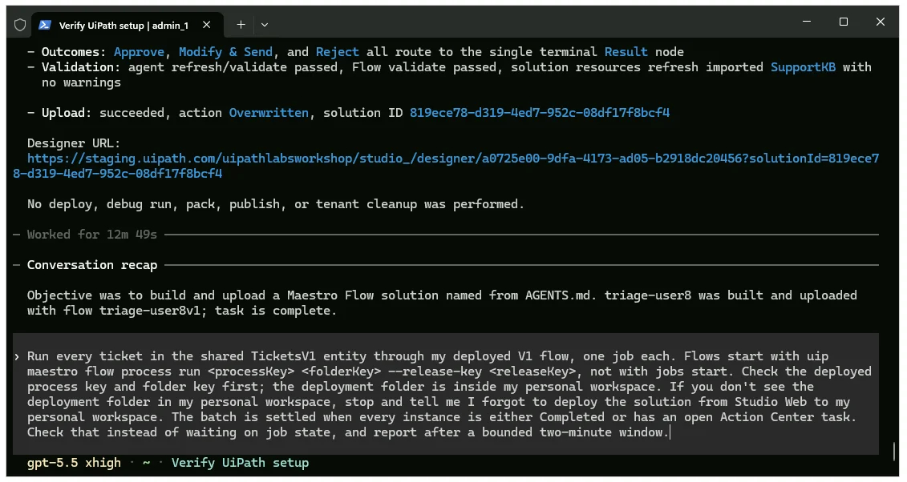
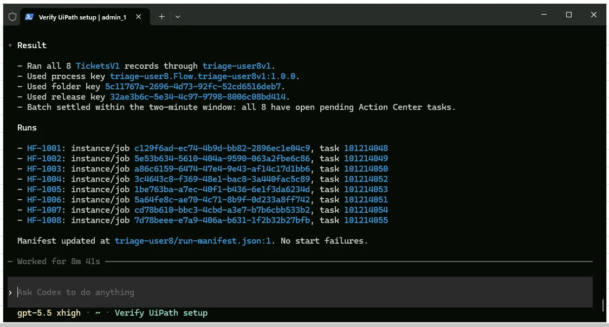
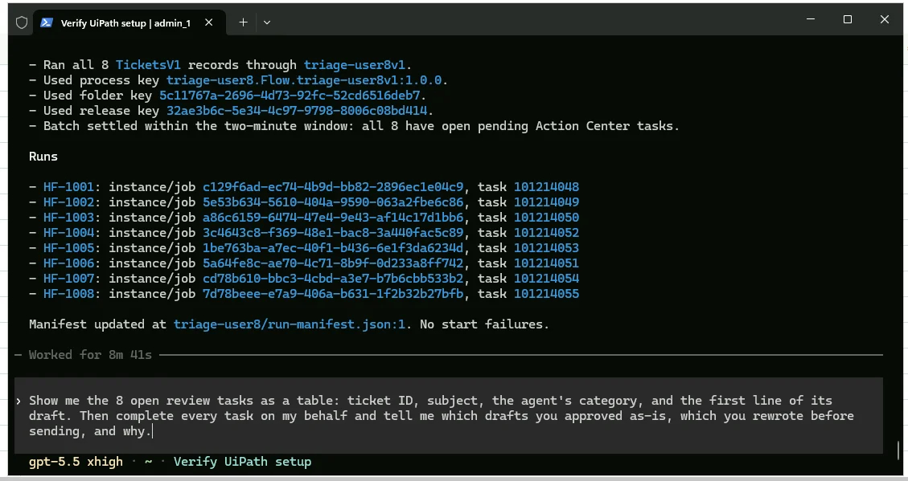
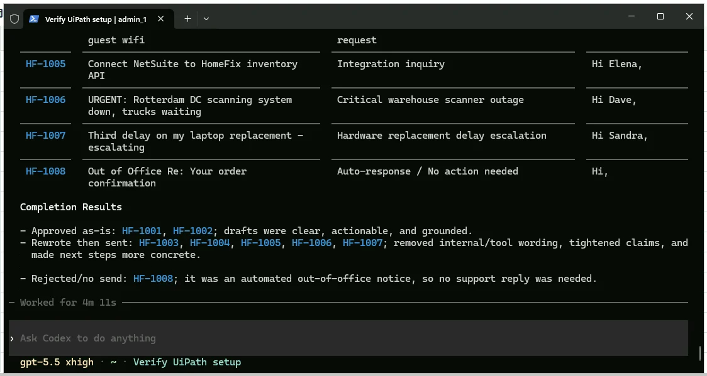

# Running and Reviewing Batch A

!!! tip "Here is our plan for this lesson:"

    1. Run the eight TicketsV1 tickets through your deployed V1 flow.
    2. Have **Codex** show you the review queue and clear it on your behalf.
    3. Read the results and spot what V1 gets wrong.

## Goal

By the end of this lesson every batch A ticket has gone through V1 and every review task is completed. More importantly, you'll know what V1 cannot see. That evidence is what Codex uses to build V2 in the next lesson.

## Learning from batch A

Batch A is where you learn what V1 gets wrong. You read, your agent completes.

Flow jobs show Running while they wait on a human, so a batch is settled when every instance is either Completed or has an open **Action Center** task. That's why the prompt asks Codex to check tasks instead of waiting on job state.

## Steps

### 1. Prompt 3: run batch A

!!! info "For this step, Codex will work for 7-8 minutes."

Return to the terminal and paste the run prompt:

```text
Run every ticket in the shared TicketsV1 entity through my deployed V1 flow, one job each. Flows start with uip maestro flow process run <processKey> <folderKey> --release-key <releaseKey>, not with jobs start. Check the deployed process key and folder key first; the deployment folder is inside my personal workspace. If you don't see the deployment folder in my personal workspace, stop and tell me I forgot to deploy the solution from Studio Web to my personal workspace. The batch is settled when every instance is either Completed or has an open Action Center task. Check that instead of waiting on job state, and report after a bounded two-minute window.
```

{ .screenshot width="900" }

Once finished, Codex should provide a summary of the runs and pending Action Center tasks.

{ .screenshot width="900" }

!!! tip "Checkpoint"
    8 review tasks in Action Center about a minute after the first job started, each already under "My tasks", not "Unassigned". Codex reports instance IDs and the task count. The error "Couldn't find any user with unattended robot permissions" should not happen. If it does, raise a hand.

### 2. Review batch A with Codex

!!! info "For this step, Codex will work for 5 minutes."

1. Ask your agent to show you the review queue and clear it:

    ```text
    Show me the 8 open review tasks as a table: ticket ID, subject, the agent's category, and the first line of its draft. Then complete every task on my behalf and tell me which drafts you approved as-is, which you rewrote before sending, and why.
    ```

    { .screenshot width="900" }

    Once finished, review the summary Codex provided on the completed tasks.

    { .screenshot width="900" }

2. While it works, read the table. Notice what V1 cannot see: the outage is not marked urgent, the out-of-office auto-reply got a task like a real ticket, and the question the knowledge base does not cover still got an answer.

!!! tip "Checkpoint"
    8 tasks completed, 0 open. Your score so far: 8 human touches for 8 tickets.
