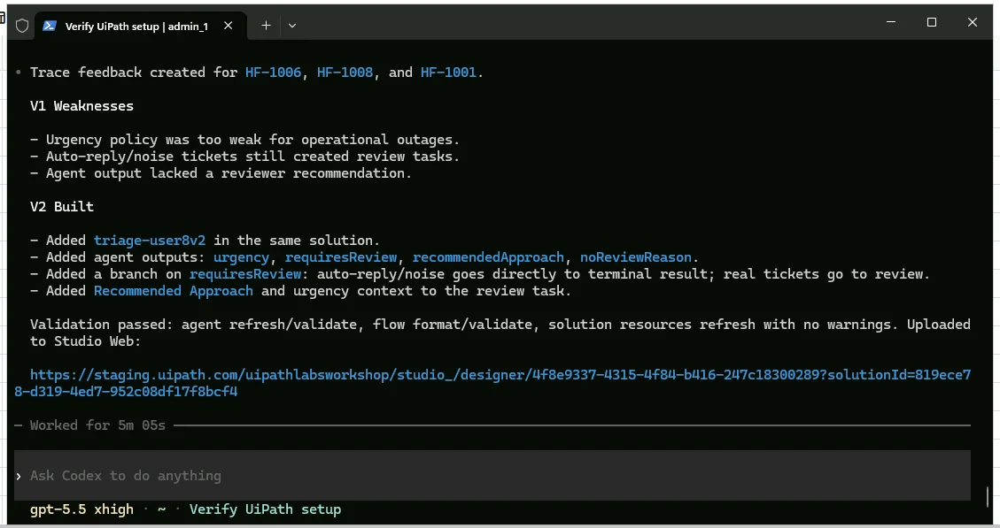
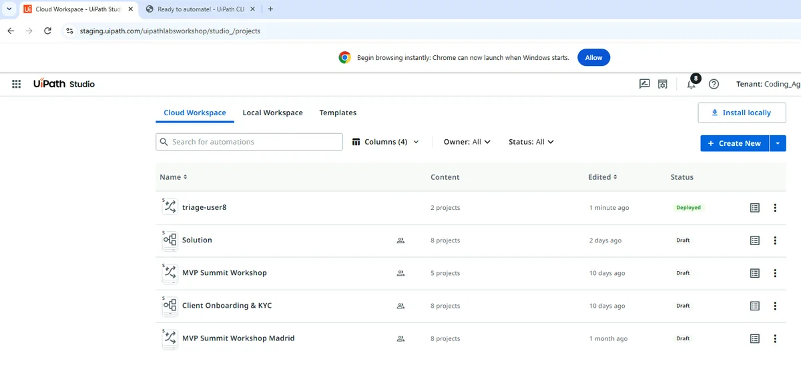
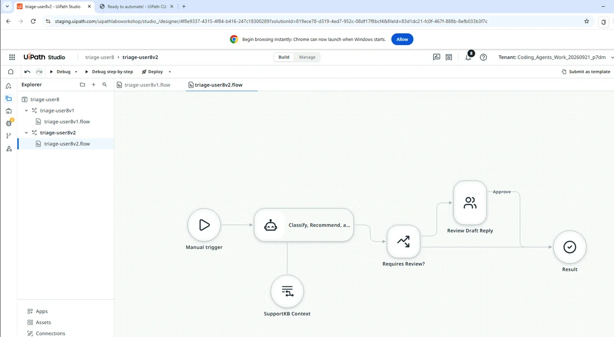
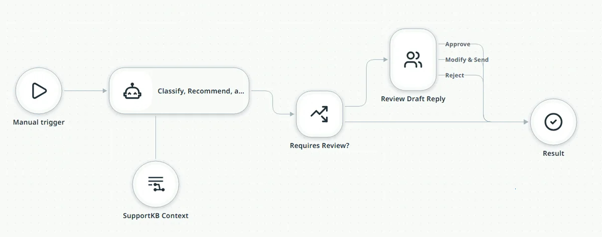
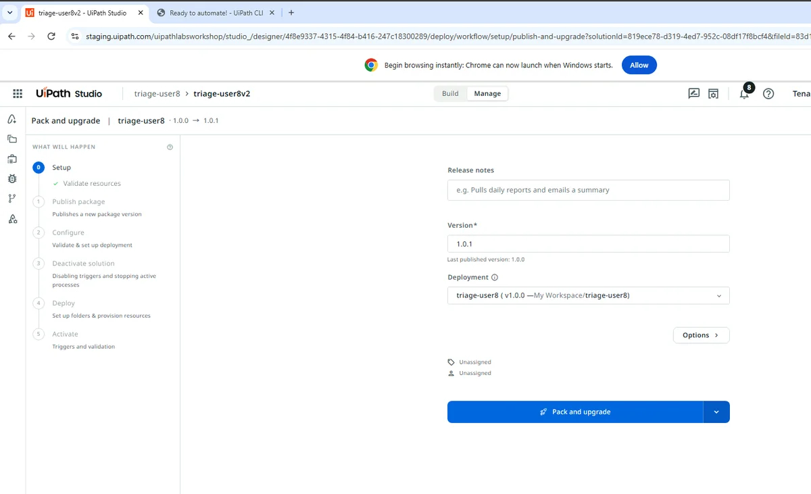
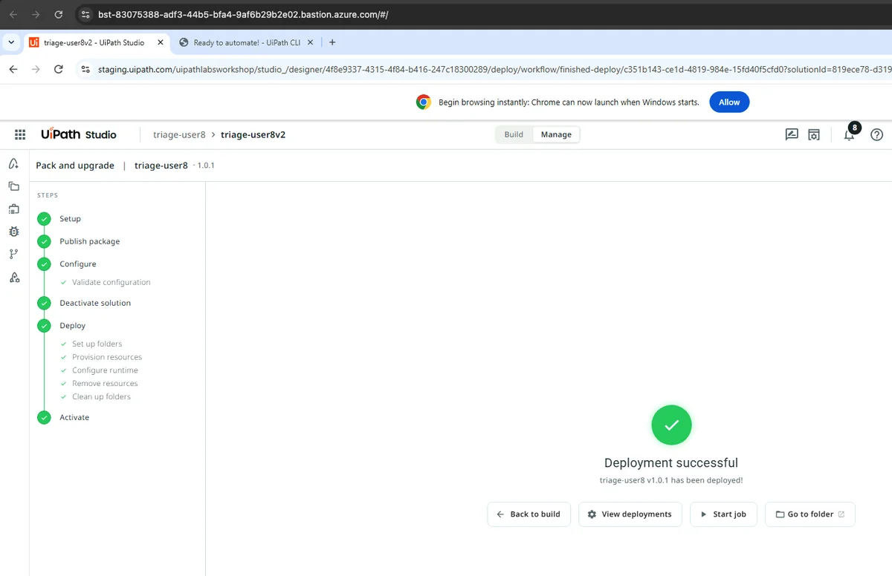

# Building V2 from Feedback

!!! tip "Here is our plan for this lesson:"

    1. Leave trace feedback on three weak V1 runs.
    2. Ask **Codex** to infer V1's weaknesses from your evidence and build V2.
    3. Connect V2's outcomes in **Studio Web**, then Pack and upgrade.

## Goal

By the end of this lesson V2 is deployed next to V1 in the same solution. It fixes what batch A exposed: urgent tickets get an urgency path, noise skips review, and every draft comes with a recommended approach for the reviewer.

## Evidence, not guesses

Codex doesn't redesign the flow from scratch. It reads two kinds of evidence: your review decisions in the completed **Action Center** tasks, and the trace feedback you leave on individual runs. Trace feedback is a positive or negative mark plus a comment, attached to a run's trace, so the weakness is recorded against the run that showed it.

## Steps

### 1. Prompt 4: leave trace feedback and build V2

!!! info "For this step, Codex will work for 5 minutes."

Paste the feedback-and-build prompt:

```text
First leave trace feedback on three of the V1 runs (uip traces feedback create needs --positive or --negative plus --comment): the outage ticket should have been treated as urgent, the auto-reply is noise that never needed review, and every draft should come with a recommended approach for the reviewer. Then look at my review decisions in the completed tasks together with that feedback, figure out what's weak in V1, and build a second flow in the same solution, named my team code followed by v2 (for example triage-user24v2), that fixes it. Validate and upload it; I'll deploy from the designer and tell you when it's done.
```

Once finished, review the summary Codex provided.

{ .screenshot width="900" }

### 2. Connect V2's outcomes in Studio Web

[[[
Return to Studio Web and open your project again.
|30|
{ .screenshot }
]]]

Click on v2 of your Flow project.

{ .screenshot width="900" }

Finish connecting the outcomes from the Action Center task to your end node.

{ .screenshot width="900" }

!!! tip "Checkpoint"
    3 feedback entries readable via `uip traces feedback list`. Codex names the weaknesses from your evidence (no urgency path, noise reviewed for nothing, no reviewer guidance) and reports a second flow with a needsReview flag, a recommendedApproach field, urgent routing to a High-priority task, and review suppressed for non-actionable noise. Both review tasks are still assigned to you. Upload needs `--force` this time; that is expected.

### 3. Deploy V2

1. In the designer, click **Pack and upgrade**, bump the version, and deploy.

    { .screenshot width="900" }

2. Wait for "**Deployment successful**" before the next prompt.

    { .screenshot width="900" }

!!! tip "Checkpoint"
    "Deployment successful" with the new version. If you prompt Codex too early it finds no V2 release and stops.
