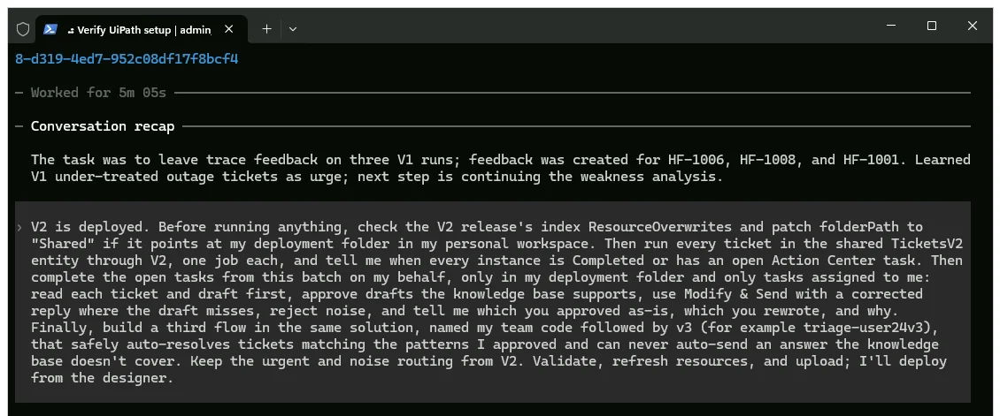
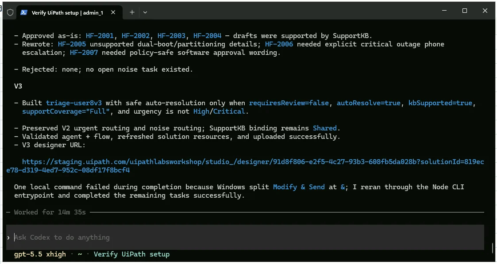
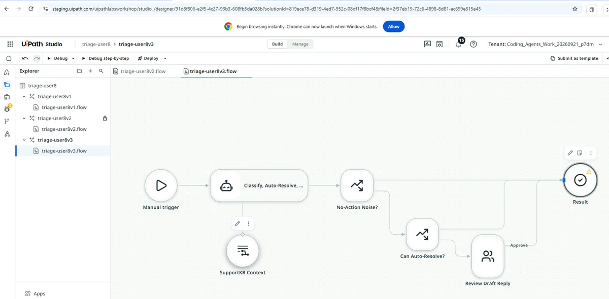
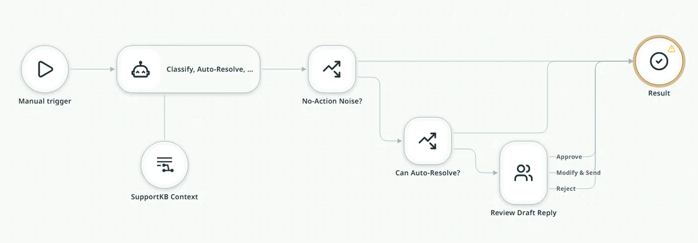
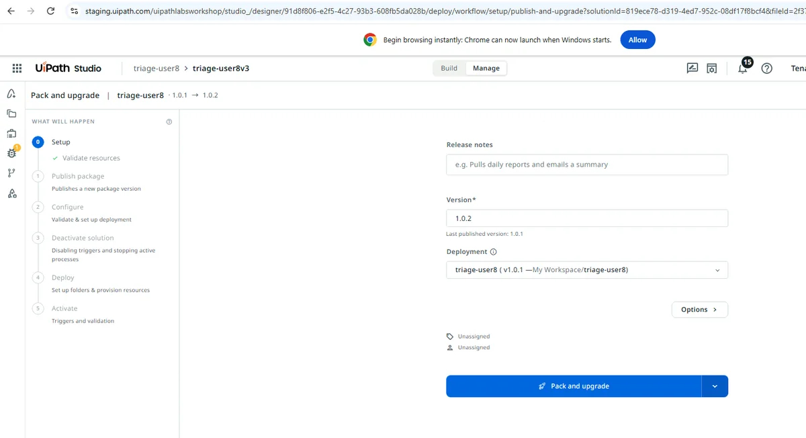
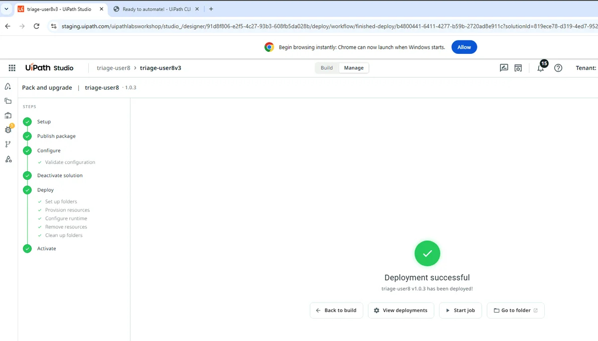

# Running Batch B and Building V3

!!! tip "Here is our plan for this lesson:"

    1. Run the TicketsV2 tickets through V2.
    2. Delegate the review of batch B to **Codex**.
    3. Have Codex build V3 with safe auto-resolution, then deploy it.

## Goal

By the end of this lesson V3 is deployed. It keeps V2's urgency and noise routing and adds a gate that auto-resolves tickets matching the patterns you approved, but only when the knowledge base actually covers the answer. Anything the gate can't vouch for still goes to human review.

## A gate that trusts evidence, not confidence

A confidence score alone isn't enough to auto-send an answer. The V3 gate has more than a confidence threshold: an explicit knowledge-coverage check, the sources actually used, and approved-pattern matching. When a check fails, the ticket goes to human review.

Delegated reviews are not human touches; the scoreboard counts them separately.

## Steps

### 1. Prompt 5: run batch B, delegate the review, build V3

!!! info "For this step, Codex works 15 minutes in three stages."

Return to your terminal and paste the combined prompt:

```text
V2 is deployed. Before running anything, check the V2 release's index ResourceOverwrites and patch folderPath to "Shared" if it points at my deployment folder in my personal workspace. Then run every ticket in the shared TicketsV2 entity through V2, one job each, and tell me when every instance is Completed or has an open Action Center task. Then complete the open tasks from this batch on my behalf, only in my deployment folder and only tasks assigned to me: read each ticket and draft first, approve drafts the knowledge base supports, use Modify & Send with a corrected reply where the draft misses, reject noise, and tell me which you approved as-is, which you rewrote, and why. Finally, build a third flow in the same solution, named my team code followed by v3 (for example triage-user24v3), that safely auto-resolves tickets matching the patterns I approved and can never auto-send an answer the knowledge base doesn't cover. Keep the improvements from V2. Optimize for higher straight-through processing: default to auto-resolve for approved recurring patterns when SupportKB evidence is present (citation(s) + sufficient confidence), auto-close clear noise, and send to review only for missing/weak KB coverage, ambiguity, or high-risk policy/urgent cases without a KB-backed response. Validate, refresh resources, and upload; I'll deploy from the designer.
```

{ .screenshot width="900" }

Once finished, review the summary.

{ .screenshot width="900" }

!!! tip "Checkpoint, batch"
    The 2 urgent tickets arrive as High-priority escalation tasks, the newsletter auto-closes with no task, and every draft carries a recommended approach. 7 review tasks created.

!!! tip "Checkpoint, delegated review"
    Codex reports each decision and reason. Expect it to rewrite drafts that restate policy without steps, or that tell an urgent requester what the knowledge base doesn't contain. 0 open tasks afterwards.

!!! tip "Checkpoint, V3"
    Codex describes a gate with more than a confidence threshold: an explicit knowledge-coverage check, the sources actually used, and approved-pattern matching. It says what happens when a check fails: human review.

### 2. Connect V3's outcomes in Studio Web

Return to **Studio Web**, open the project again and open the v3 flow.

{ .screenshot width="900" }

Finish connecting any exit lines from the **Action Center** task to the end node.

{ .screenshot width="900" }

### 3. Deploy V3

1. **Pack and upgrade** again, bump the version, and wait for "**Deployment successful**".

    { .screenshot width="900" }

    { .screenshot width="900" }

!!! tip "Checkpoint"
    The deployment log shows the new version active.
